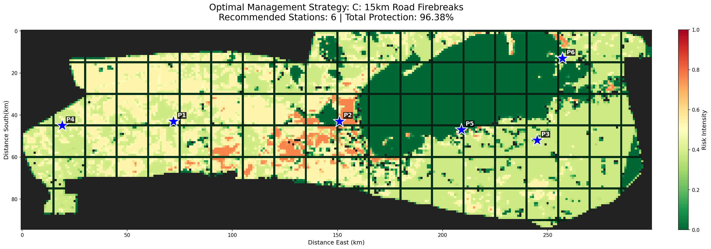
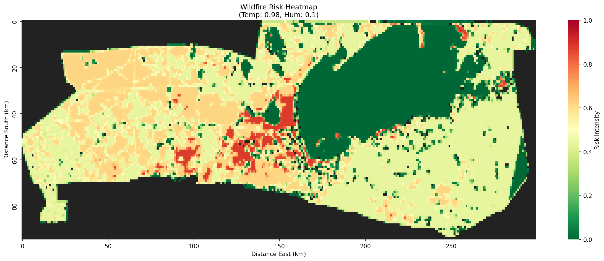
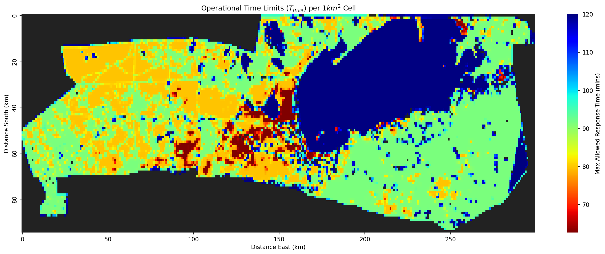
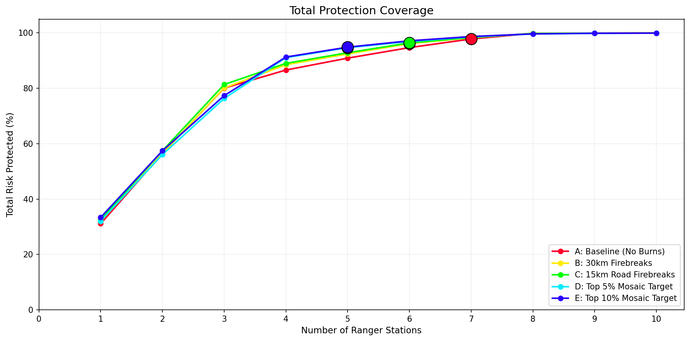
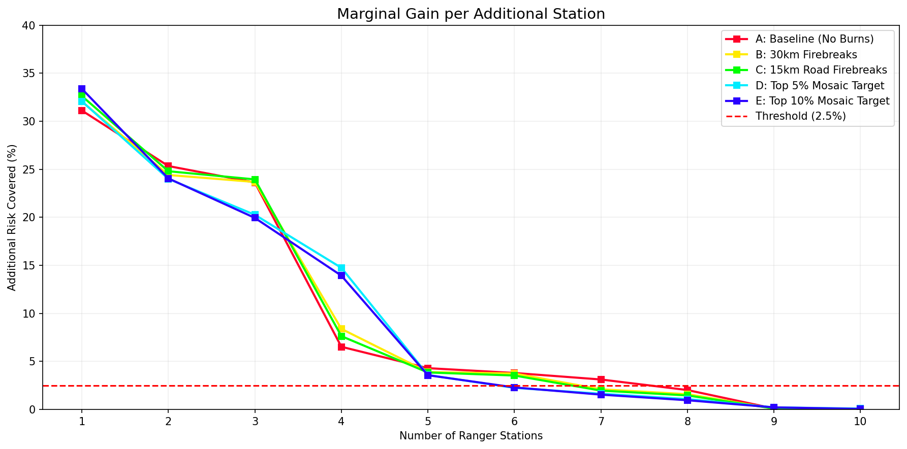
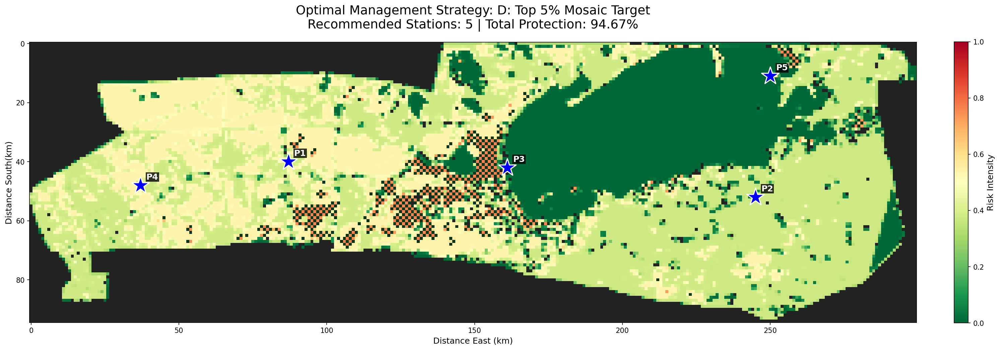

# Etosha National Park Wildfire Model

Maps wildfire risk across Etosha National Park from a vegetation map, tests five prescribed-burn strategies, and places ranger stations so that the most fire risk can be reached within a risk-based response time.



## Setup

Requires Python 3.9+.

```bash
pip install numpy pandas matplotlib scipy pillow seaborn
```

## Usage

```bash
python FireSpread.py
```

- Runs all five strategies with 1–10 stations each (about 5-7 minutes).
- Each figure opens in a window, close it to continue.
- Results are saved to `results/` as `fire_strategy_detailed_<timestamp>.csv` and `fire_strategy_summary_<timestamp>.csv`.

```bash
python Plotting.py
```

- Draws the coverage and marginal-gain charts from the newest CSV in `results/`.
- An example CSV is included, so you can run this without running `FireSpread.py` first.

To change the weather, edit `current_temp` and `current_humidity` in `FireSpread.py` (both use a 0–1 scale.)

## Files

```
FireSpread.py        risk model, burn strategies, station placement
Plotting.py          coverage charts from saved results
VegMap_NoBG_cp.png   input vegetation map
results/             CSV output (example included)
```

## Method

1. **Fuel:** each map pixel is classified as grass (1.0), shrub (0.7), tree (0.5) or salt pan (0.0).
2. **Risk:** `0.5 × ignition + 0.5 × spread`, where `ignition = temp × (1 − humidity) × fuel` and `spread` is the smoothed ignition of neighbouring cells. The map is resampled to a 1 km grid.
3. **Response time limit:** `T_max = 120 − 75 × risk` minutes, with a minimum of 30.
4. **Burn strategies:** burned cells keep 15% of their risk.
5. **Station placement:** a greedy search adds each station where it covers the most uncovered risk. Travel speed is 60 km/h on roads and 30 km/h off-road. The recommended number of stations is the last one that adds at least 2.5% coverage.





## Results

Run with temp = 0.85 and humidity = 0.10:

| Strategy | Stations | Total protection |
|---|---|---|
| A: Baseline (no burns) | 7 | 97.81% |
| B: 30 km firebreaks | 6 | 96.15% |
| C: 15 km road firebreaks | 6 | 96.38% |
| D: Top 5% mosaic burn | 5 | 94.67% |
| E: Top 10% mosaic burn | 5 | 94.85% |





### Station maps

| A: Baseline | B: 30 km firebreaks |
|---|---|
|  |  |
| **D: Top 5% mosaic** | **E: Top 10% mosaic** |
|  |  |